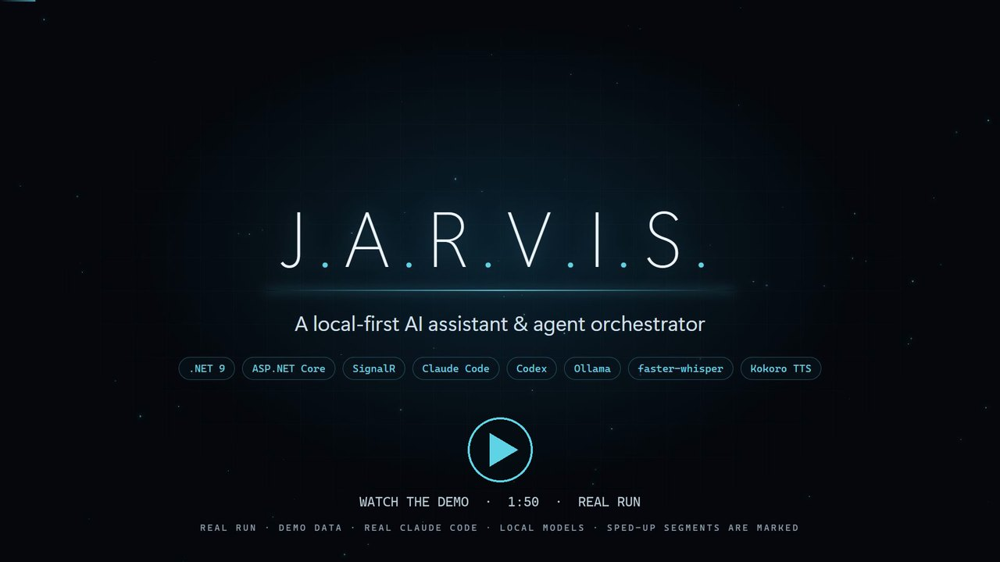
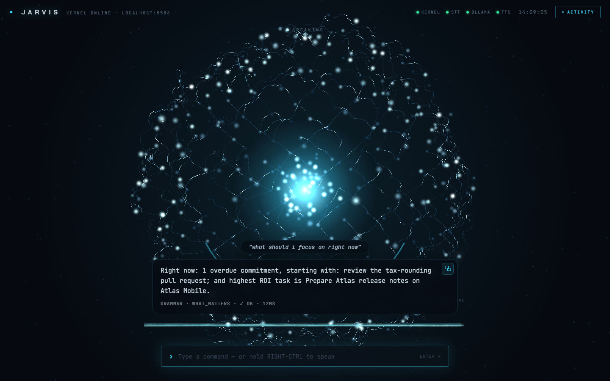
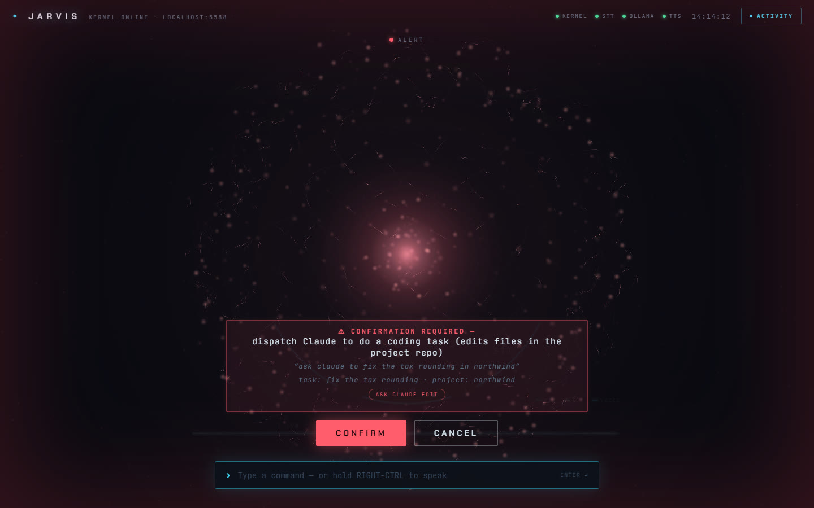
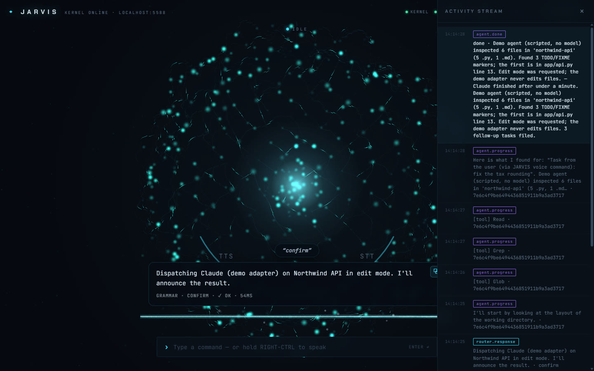
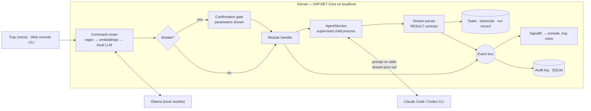

# J.A.R.V.I.S.

A local-first AI assistant and agent orchestration system for Windows.

JARVIS takes spoken or typed commands, routes them through a three-tier intent router
(regex grammar, local embeddings, local LLM), and either answers from local data or
dispatches the work to coding agents. Claude Code and Codex run as supervised child
processes. JARVIS streams their output, parses a structured result contract, and turns
each run's findings into tracked tasks and a spoken summary. Actions that change code or
leave the machine wait for an explicit confirmation, and every routing decision and
event is written to an audit log that JARVIS can explain on request.

It is a working system I built and use daily. This repository is a sanitized public
edition: the source is the real implementation, and it ships with a safe demo mode
([what that means](docs/PUBLIC-EDITION.md)).

## Demonstration

[](https://github.com/omartarek198/jarvis/releases/download/v1.0.0/jarvis-demo.mp4)

A real run of this repository's public edition: typed commands, a real Claude Code edit
run, local Ollama models and JARVIS's own Kokoro voice. Sped-up segments are marked on
screen. How it was recorded and edited: [docs/DEMO-VIDEO.md](docs/DEMO-VIDEO.md).

| Answering from local data | Confirmation gate | Agent run, streamed live |
|---|---|---|
|  |  |  |

## What it does

- **Commands by voice or text.** Push-to-talk or the "hey Jarvis" wake word through a tray
  app; typed commands in a web console or CLI. 148 commands across 30 modules: tasks,
  commitments, reminders, notes, git status, project briefings, focus tracking, meetings,
  Jira, email and more.
- **Hybrid intent routing.** Anchored regex grammar first (milliseconds). Then semantic
  similarity over embedded example utterances, with a local LLM used only to fill slots or
  break ties between the top candidates. Then a local-model answer. Saying "that's wrong"
  teaches the router to stop sending similar utterances to that command.
- **Agent orchestration.** "Ask Claude to fix …", "ask Codex to review the latest
  changes", "Claude, plan …", "follow up: …". Each run is a supervised process with a
  permission profile (plan mode, explicit tool allowlists or `acceptEdits`; Codex
  sandboxes). Output is parsed as it streams, and the final `RESULT` block becomes a
  summary, a list of changes and follow-up tasks. Claude sessions can be resumed for
  follow-up questions.
- **Safety and audit.** 19 Mutate commands park until "confirm", and the prompt names
  the concrete parameters. Every utterance gets an audit row (tier, confidence, slots,
  tool, status, duration), and every event is persisted. "What did you just do", "why
  did you do that", "retry that", "send that to Claude" and "how reliable are you" all
  read that trail.
- **Local speech.** faster-whisper STT (CUDA with CPU fallback), openWakeWord, and Kokoro
  TTS with Piper and Windows SAPI fallbacks, voice profiles, a mastering chain and a
  phrase cache. Barge-in, conversation mode, dictation into any window, and a meeting
  scribe that transcribes both sides of a call.
- **The Council.** A multi-persona decision aid. Advisers chosen per decision category
  (CEO, CTO, Operator, Skeptic, …) argue in sequence using a local model, cross-examine
  each other, and vote. Each adviser speaks with its own voice, and decisions can become
  tasks or reminders. It degrades to deterministic templates when no model is available.
- **Live console.** A three.js orb that reflects system state, the activity stream over
  SignalR, the confirmation bar, a voice scope, and Council and per-project "war room"
  pages. Also a phone PWA (LAN, key-guarded) and a Codex relay for phone access.

## Architecture



The full lifecycle (with a sequence diagram), the agent permission profiles, the voice
pipeline and the background services are documented in
[docs/ARCHITECTURE.md](docs/ARCHITECTURE.md). The voice stack, with measured latencies
and the engine evaluation, is in [docs/VOICE.md](docs/VOICE.md).

## Key engineering decisions

**CLI agents instead of API calls.** Coding work goes to the Claude Code and Codex CLIs
rather than raw model APIs. They already handle repository context, tool use and
sandboxing; they run on existing subscriptions with no per-token keys; and swapping or
adding an agent means changing one argument builder. JARVIS's job is orchestration:
choosing the agent and permission profile, supervising the process, and making the
result useful afterwards.

**A result contract instead of free text.** Every agent prompt ends with an instruction to
finish with `RESULT: {summary, changes, followUps, risks}`. A balanced-brace scan pulls
the last block out of the streamed output, so a run produces structured data: the
summary is spoken, follow-ups become tasks, and the record links back to the full
transcript.

**Supervised processes, observable while running.** Agents are child processes with
redirected streams, never shell invocations. The prompt goes in on stdin and never on a
command line. Each stdout line is written to a per-run transcript and turned into
progress events, so the console shows tool calls as they happen. One "stop everything"
command kills every process tree.

**Deterministic first, models second.** Most commands match an anchored regex in under a
millisecond. Embeddings decide which command an utterance means only when the grammar
misses; the LLM then just extracts parameters or chooses among three candidates. The
small local model never makes an open-ended routing decision on its own, and a
correction it gets wrong once doesn't happen again.

**Confirmation where it matters, with specifics.** Safety is declared per command
(`Read`, `WriteLocal`, `Mutate`). Mutate handlers are parked with their context and run
against a fresh dependency-injection scope when "confirm" arrives. The prompt repeats
the parameters ("task: fix the tax rounding; project: northwind"), so you approve the
action itself, not a description of it.

**One event bus, two consumers.** Modules and services publish events. A SignalR
forwarder pushes them to the console and the tray, and an audit subscriber persists
them. Adding a UI feature or an announcement means subscribing to an event kind, not
threading callbacks through the code.

**Graceful degradation everywhere.** Sidecars are supervised and adopted if already
running; TTS falls back from Kokoro to Piper to SAPI to text; routing falls back from
embeddings to the grammar tier; the Council falls back to deterministic templates; a
missing agent CLI produces a prompt pack on the clipboard. The kernel starts and is
useful with only the .NET SDK installed.

## Technology

| Area | Stack |
|---|---|
| Kernel | C# / .NET 9, ASP.NET Core minimal APIs, hosted services, SignalR, EF Core + SQLite (FTS5), Swagger |
| Desktop client | WinForms, NAudio (WASAPI capture, loopback, playback), Win32 low-level keyboard hook, `SendInput` |
| Agents | Claude Code CLI (`stream-json`, permission modes, tool allowlists, MCP connectors), Codex CLI (`exec`, sandboxes) |
| Local AI | Ollama (`qwen2.5:3b` / `qwen2.5:7b`, `nomic-embed-text`), faster-whisper, openWakeWord, Kokoro-82M (ONNX), Piper |
| Sidecars | Python 3.10+, FastAPI, uvicorn |
| Web | Vanilla JavaScript, three.js, SignalR client |
| Integrations (opt-in) | MailKit (SMTP/IMAP), Microsoft Graph, Outlook COM, Atlassian and Microsoft 365 MCP via Claude, ntfy, `npx playwright test` |
| Tests | xUnit (98 tests) |

## Running it

**Requirements:** Windows 10 or 11 and the .NET 9 SDK. Everything else is optional.

```powershell
git clone https://github.com/omartarek198/jarvis.git
cd jarvis
dotnet build Jarvis.sln
dotnet run --project src/Jarvis.Kernel
```

Open http://localhost:5588 and type a command, or use the CLI from a second terminal:

```powershell
$jarvis = "src\Jarvis.Cli\bin\Debug\net9.0\Jarvis.Cli.exe"
& $jarvis "what should I focus on right now"
& $jarvis "ask claude to fix the tax rounding in northwind"   # parks for confirmation
& $jarvis "confirm"                                           # runs the demo agent on samples/northwind-api
& $jarvis "what did claude find"
& $jarvis "list tasks for northwind"                          # the agent's follow-ups, now tasks
& $jarvis "why did you do that"
& $jarvis "how reliable are you"
```

`scripts/demo.ps1` runs this sequence with headings, and `http://localhost:5588/swagger`
lists the REST API. The first start creates `data/` with a SQLite database of fictional
projects, people and tasks.

**Optional components**

| To enable | Install | Notes |
|---|---|---|
| Semantic routing, general answers, LLM Council | [Ollama](https://ollama.com) + `ollama pull qwen2.5:3b qwen2.5:7b nomic-embed-text` | Detected automatically at `127.0.0.1:11434` |
| Voice (tray, STT, wake word, Kokoro) | Python 3.10+, `pip install -r voice/stt/requirements.txt -r voice/wake/requirements.txt -r voice/kokoro/requirements.txt`, Kokoro model files ([details](docs/VOICE.md#model-files-not-in-the-repository)) | Run `src\Jarvis.Tray\bin\Debug\net9.0-windows\Jarvis.Tray.exe` and hold Right-Ctrl. SAPI speaks with no setup. An NVIDIA GPU speeds up STT. |
| Real agents | Claude Code CLI and/or Codex CLI, signed in | Set `Jarvis__Agents__Mode=cli` ([details](docs/PUBLIC-EDITION.md#running-against-real-tools)) |
| Email, Teams, notifications, OS control | Credentials in the DPAPI store, `Jarvis:ExternalActions:Enabled=true` | Off by default ([security model](SECURITY.md)) |

**Tests**

```powershell
dotnet test tests/Jarvis.Tests
```

Includes end-to-end runs of the agent pipeline: `AgentService` launches the demo agent as
a child process, parses its stream and RESULT block, and files follow-up tasks, in both
the Claude and the Codex output format.

## Public edition scope

The code is the real system. Personal data, credentials, account identifiers, private
integrations (including the email-driven away-mode daemon), model binaries and the
original git history are not included. Two things are clearly marked as stand-ins: the
`jarvis-demo-agent` adapter, which replaces the agent CLIs in demo mode, and the console's
`?sim=1` UI simulation. Everything else runs for real; the exact list is in
[docs/PUBLIC-EDITION.md](docs/PUBLIC-EDITION.md).

## Limitations

- **Windows only.** The tray, audio stack, SAPI and the DPAPI secret store are
  Windows-specific; the kernel depends on the secret store at startup.
- **Single user, single machine.** Loopback callers are trusted, and the confirmation gate
  guards against mistakes, not against a malicious local process ([SECURITY.md](SECURITY.md)).
- **Routing coverage.** Paraphrases that match no pattern and score below the similarity
  threshold fall through to a general answer from the local model rather than the
  intended command. Small local models also produce uneven Council arguments and can
  state details that were never given.
- **No streaming speech.** A reply is rendered in full before playback starts, so long
  answers take a few seconds to begin.
- **Setup cost for the full system.** Voice needs Python packages and ~354 MB of Kokoro
  model files; semantic routing needs Ollama models; real agents need the CLIs and
  accounts. Without them, the demo mode described above still runs end to end.
- **Not productised.** No installer and no CI pipeline; the multi-machine tables in the
  schema are not implemented.

## Author

**Omar Tarek Ali** — [github.com/omartarek198](https://github.com/omartarek198)

Released under the [MIT License](LICENSE).
