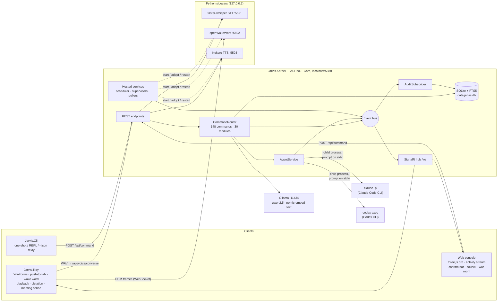

# Architecture

This document describes the system as implemented. File references are relative to the
repository root.

## Processes



| Process | Role | Address |
|---|---|---|
| `Jarvis.Kernel` | Command routing, modules, persistence, agent orchestration, REST + SignalR, sidecar supervision, static web console | `http://localhost:5588` (loopback only) |
| `Jarvis.Tray` | Global Right-Ctrl hook (`WH_KEYBOARD_LL`), NAudio capture at 16 kHz mono, wake-word client, reply playback with barge-in, dictation via `SendInput`, meeting scribe (WASAPI loopback + mic) | — |
| `Jarvis.Cli` | Text client; `--json --source relay` is the contract the Codex phone relay uses (`AGENTS.md`) | — |
| `voice/stt/server.py` | faster-whisper (`base.en` default), tries CUDA int8/fp16 then CPU int8 | `127.0.0.1:5591` |
| `voice/wake/server.py` | openWakeWord `hey_jarvis` (or a custom model), 80 ms frames over WebSocket | `127.0.0.1:5592` |
| `voice/kokoro/server.py` | Kokoro-82M via kokoro-onnx on CPU | `127.0.0.1:5593` |
| Ollama | Embeddings for semantic routing, slot extraction, gray-zone intent choice, general answers, Council statements | `127.0.0.1:11434` |
| LAN listener (opt-in) | HTTPS on 5589 for the phone PWA, key-guarded | off by default |

The kernel's `SttSupervisor`, `WakeSupervisor` and `KokoroSupervisor` start each sidecar
with the `python` on PATH. If a healthy process already holds the port they adopt it,
pipe its logs into the kernel log, health-check it every 30 seconds and restart it after
an exit, giving up after 30 rapid failures. Missing scripts or model files disable the
supervisor instead of looping.

## Command lifecycle

```mermaid
sequenceDiagram
    autonumber
    participant U as User (voice / console / CLI)
    participant K as Kernel API
    participant R as CommandRouter
    participant P as PendingActionService
    participant H as Module handler
    participant A as AgentService
    participant C as claude / codex (child process)
    participant B as Event bus
    participant D as SQLite

    U->>K: utterance (WAV is transcribed by the STT sidecar first)
    K->>R: RouteAsync(text, source)
    R->>B: router.transcript
    Note over R: active Council session gets first claim
    R->>R: tier 1 regex → tier 2 semantic/LLM → tier 3 general answer → fallback
    alt SafetyClass.Mutate
        R->>D: CommandLog (status awaiting_confirm, slots)
        R->>P: park handler (single slot, 2-minute TTL)
        R->>B: safety.confirm_request {command, slots}
        R-->>U: "This will … (task: …; project: …). Say confirm."
        U->>R: "confirm"
        R->>P: ConfirmAsync() — runs the parked handler with a live DI scope
    end
    R->>H: handler(ctx)
    H->>A: DispatchAsync(agent, prompt + RESULT contract, repo, edit?)
    A->>D: AgentRun (running)
    A-->>U: "Dispatching Claude on Northwind API…"
    A->>C: start process in repo dir, write prompt to stdin
    loop each stdout line
        C-->>A: stream-json (claude) or text (codex)
        A->>D: append to transcript .jsonl
        A->>B: agent.progress (assistant text, [tool] names)
    end
    A->>A: parse last RESULT {summary, changes, followUps, risks}
    A->>D: AgentRun done · followUps become TaskItems
    A->>B: agent.done {spoken, summary}
    B-->>U: console activity stream · tray speaks it
    R->>D: CommandLog row finalized (tier, confidence, tool, status, run id, ms)
```

### Routing tiers (`src/Jarvis.Kernel/Services/CommandRouter.cs`)

1. **Grammar.** Every `CommandDefinition` carries anchored regexes with named groups that
   become slots. Patterns are compiled once with a 1-second match timeout and tried in
   module registration order. Registration order is deliberate: specific modules come
   before greedy ones (`Program.cs` documents each ordering constraint). A handler can
   return `Unhandled` to let lower tiers try.
2. **Semantic** (`SemanticRouter.cs`). At startup every command's name, description and
   example utterances are embedded with `nomic-embed-text`; vectors are normalised so
   cosine similarity is a dot product. Similarity ≥ 0.78 routes directly and the local
   LLM only extracts slots. Between 0.62 and 0.78 the LLM picks among the top three
   candidates or answers "general". "That's wrong" stores the utterance's embedding as a
   correction; anything within 0.86 of it can never route to that intent again. Until
   the index is ready, a legacy path asks the LLM to choose from the full catalog.
3. **General answer** (`DialogServices.cs`). The local answer model replies with the
   current date/time, a capped set of stored facts and recent dialog as context; for
   questions that look like live data it adds web snippets.
4. **Fallback** — logged as `unhandled` so the reliability report shows routing gaps.

### Safety classes

| Class | Count | Behaviour |
|---|---|---|
| `Read` | 75 | Runs immediately |
| `WriteLocal` | 54 | Runs immediately, local writes, audited |
| `Mutate` | 19 | Parked; runs only after "confirm" within 2 minutes. Agent edit runs, Jira writes, email, mailbox changes, screen capture, PC lock |

The confirmation gate protects against misrecognised speech and accidental commands. It
is not an authorization boundary: any caller that can reach the API can also send
"confirm". See [`SECURITY.md`](../SECURITY.md).

## Agent orchestration (`src/Jarvis.Kernel/Services/AgentService.cs`)

- **Process model.** One child process per run, started with `UseShellExecute=false`,
  stdout/stderr redirected, no window. The prompt goes to stdin, so user-derived text never
  appears on a command line (relevant when a CLI resolves to an npm `.cmd` shim). Running
  processes are tracked; "stop everything" (`system.stop`) kills each process tree.
- **Claude Code.** `claude -p --output-format stream-json --verbose`, with permissions
  chosen per command:
  - read-only runs use `--permission-mode plan`, or an explicit `--allowedTools` list when
    they need MCP tools (Jira reads use only the Atlassian read tools);
  - edit runs use `--permission-mode acceptEdits` with a tool allowlist (Read/Edit/Write/
    Glob/Grep plus specific `dotnet build|test`, `git status|diff|log`, `npm test`,
    `npx playwright test` patterns);
  - Jira writes add exactly the mutation tools they need, still without local edit rights.
- **Codex.** `codex exec --sandbox read-only|workspace-write -`.
- **Streaming.** Claude lines are parsed as JSON: `system` lines yield the session id,
  `assistant` text and `tool_use` blocks become `agent.progress` events, `result` holds the
  final text. Codex output is relayed line by line. Every raw line is written to a
  per-run JSONL transcript under `data/brains/<project>/agent-runs/`.
- **Result contract.** Each prompt ends with an instruction to finish with
  `RESULT: {"summary", "changes", "followUps", "risks"}`. The last block is extracted
  with a string-aware balanced-brace scan. `followUps` become tracked tasks
  (`Source = agent`), and the summary becomes the spoken announcement.
- **Conversations.** Claude runs store their session id; "follow up: …" resumes with
  `--resume`, and runs without a session fall back to a fresh run carrying the previous
  summary. "Retry that with edits" re-runs a read-only investigation in edit mode (Mutate).
- **Degradation.** If a CLI is missing, the full prompt is written to `data/outbox/` and
  copied to the clipboard.
- **Demo adapter.** With `Jarvis:Agents:Mode=demo`, both agents resolve to
  `jarvis-demo-agent` (`src/Jarvis.DemoAgent`), which accepts the same arguments and emits
  the same formats from a deterministic, read-only scan of the target directory.
  Everything above runs unchanged; `tests/Jarvis.Tests/PublicEditionTests.cs` exercises
  the full path for both agent types.

Agent-backed commands include coding tasks and questions, Codex review of recent changes,
feature planning (steps become tasks), standup summaries of uncommitted work, Jira
queries and writes through Claude's Atlassian MCP connector, explaining what is on screen,
and handing a failed Playwright run to Claude.

## Events, audit and persistence

- **Event bus** (`src/Jarvis.Core/EventBus.cs`): in-process publish/subscribe; each
  subscriber runs on its own task, and exceptions are contained.
- **SignalR** (`EventForwarder`): every event is broadcast as `event` to `/ws` clients.
  The console and tray only listen; commands go through REST.
- **Audit**: `AuditSubscriber` persists every event except high-frequency telemetry
  (`agent.progress`, `voice.levels`, …) to the `Events` table. Separately, the router
  writes one `CommandLog` row per utterance: source, tier, confidence, intent, slots,
  safety class, tool, status, error, agent-run id and duration. Voice commands read this
  table: "what did you just do", "why did you do that", "retry that", "send that to
  Claude", "how reliable are you".
- **Storage**: EF Core on SQLite (`EnsureCreated`) plus a keyed, append-only
  `SchemaUpgrader` for existing databases. An FTS5 table indexes notes, commitments, tasks
  and `data/brains/**/*.md` (re-indexed 30 s after any change) for "search memory" and as
  retrieval context for Claude questions.
- **Secrets**: a DPAPI-protected (CurrentUser) map in `data/secrets.bin`. Credentials are
  imported from a one-shot `data/setup-secrets.json` that is deleted after import.

## Voice pipeline

The tray records while Right-Ctrl is held (or for up to 7 s after the wake word), sends
one `POST /api/voice/converse`, and receives the reply as a WAV body. Transcript, intent,
confirmation state and listen-again flags travel in URL-encoded `X-Jarvis-*` headers, so a
turn is a single round trip. Speech output goes through one choke point,
`TtsService.SynthesizeAsync`: profile selection, a speech-text formatter, chunking,
Kokoro → Piper → SAPI fallback, a pure C# mastering chain and a phrase cache. Details and
measurements: [`VOICE.md`](VOICE.md).

## The Council (`src/Jarvis.Kernel/Services/Council/`)

A structured decision aid: "quick council: <decision>", "full council", "war council",
"emergency council".

1. A classifier maps the decision to a category (regex rules first, then the local
   model). The category selects a roster from nine adviser lenses (CEO, CTO, Operator,
   Investor, Health Coach, Skeptic, Future You, Customer Voice, Sales). Quick mode takes
   three.
2. JARVIS asks category-specific clarifying questions it doesn't already know the answer
   to (one in quick and emergency mode, up to three otherwise).
3. Statements are generated sequentially, so each adviser sees what the others said. Each
   has a mandatory "signature move" and must cite a stated fact without inventing new
   ones. With Ollama unavailable, deterministic per-lens templates keep the feature
   working offline.
4. Full and war councils add a cross-examination round and ask the user for their
   priority, which re-weights the lenses.
5. A weighted vote produces a recommendation and a confidence. The offered next action can
   become a task, reminder, focus session or commitment, or be handed to Claude.
6. Sessions, turns, votes and actions are stored and can be recalled by voice; each adviser
   speaks with its own voice profile; `council.html` renders sessions live.

## Background services

| Service | What it does | Default in the public edition |
|---|---|---|
| `SchedulerService` | Reminders and alarms, morning briefing (07:30), Friday weekly review, habit and focus nags, sleep inference, daily SQLite backup (14 kept) | On. The optional git snapshot of `data/brains` is off (`Jarvis:Backups:CommitBrains`) |
| `FocusSampler` | Samples the foreground process and window title every 5 s for focus reports | Off (`Jarvis:Focus:SampleForegroundWindow`) |
| `BrainWatcher` | Keeps the FTS index of `data/brains` fresh | On |
| `EmailPoller` / `TeamsPoller` | IMAP and Microsoft Graph polling for VIP announcements | Inert unless external actions are enabled and credentials exist |
| `NtfyService` | Forwards selected spoken events to ntfy.sh | Off (external actions) |
| STT / wake / Kokoro supervisors | Sidecar lifecycle | On; self-disable when Python, scripts or models are missing |

## Web console (`src/Jarvis.Kernel/wwwroot/`)

Vanilla JavaScript, no build step. `orb.js` renders a three.js "neural lattice" that
reflects state (idle, listening, thinking, speaking, alert, stopped) and draws a comet per
running agent; `live.js` connects to SignalR and polls health; `app.js` renders
transcripts, responses with audit lines, the confirmation bar, a three-channel voice
scope fed by the tray, and the activity stream. `?sim=1` replaces the live connection with
a scripted UI simulation (canned events, no kernel calls) for design work — it is a
simulation, not a demo of the backend. Other pages: `council.html`, `warroom.html`
(per-project aggregate), `mobile.html` (phone PWA).

## Not implemented

The schema contains `Machine`/`MachineCommand` tables for a multi-PC fleet; no fleet
coordination exists. There is no CI pipeline and no installer.
